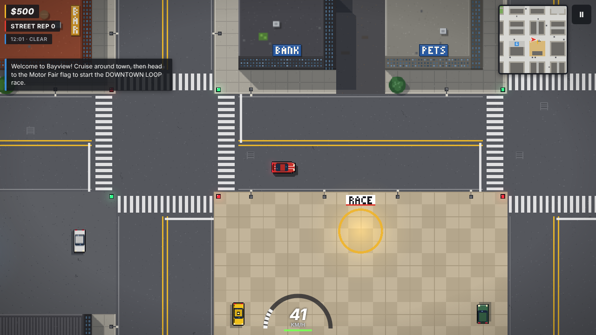
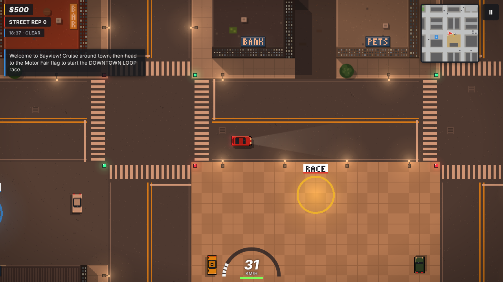
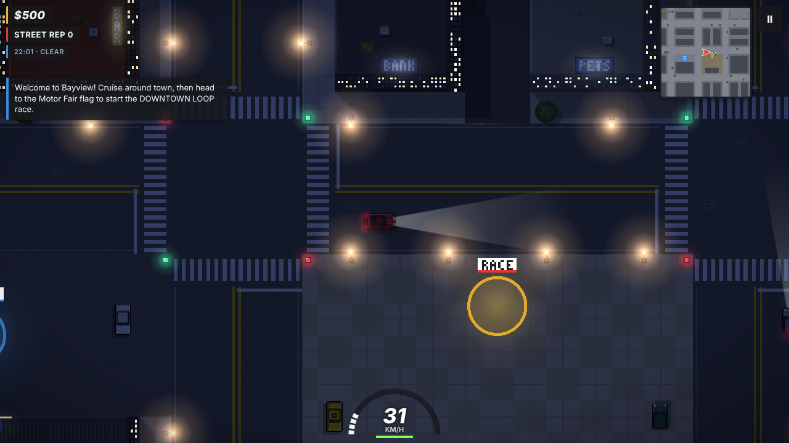
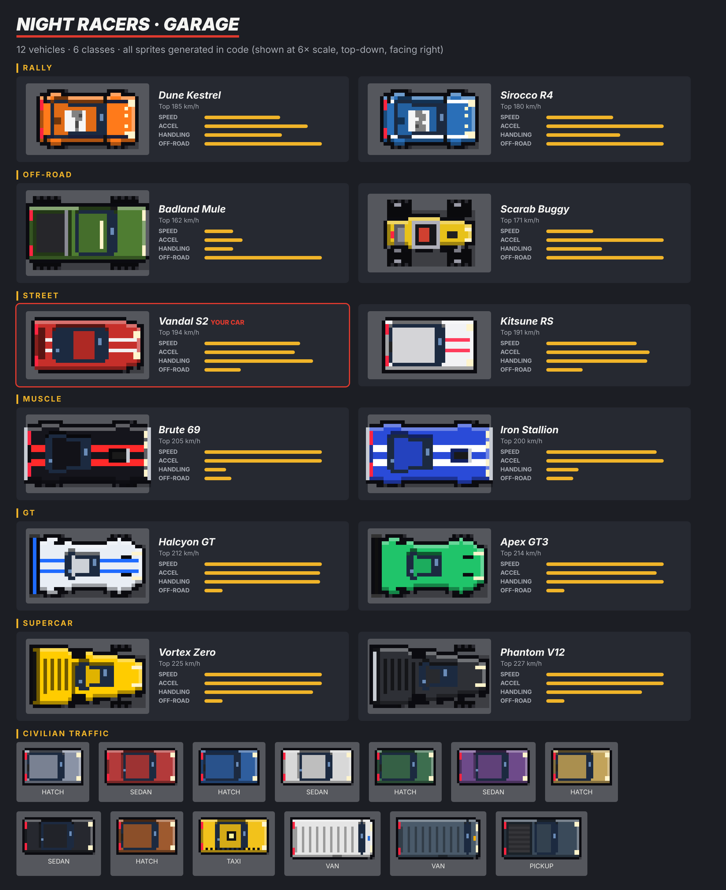
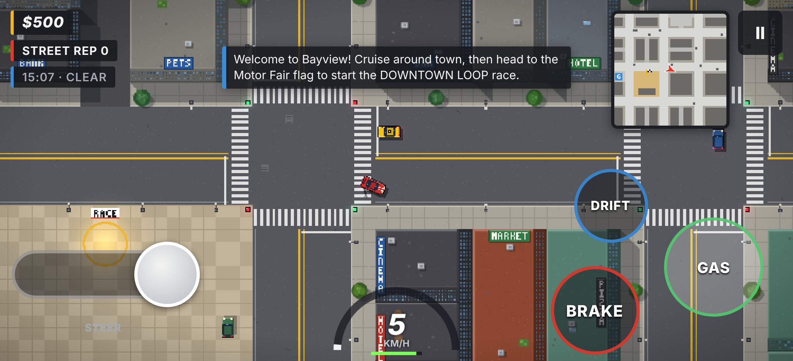

# NIGHT RACERS — Bayview

Open-world, top-down arcade racing, built for the browser (mobile-first).
This is **Milestone 1: the playable Bayview downtown prototype** from the [design spec](docs/SPEC.md).

> **Changes from the spec** (`docs/SPEC.md` is kept as originally written):
> - **No neon theme.** The game uses a natural look with a full **day/night cycle**. Place names changed to match:
>   Neon Bay → **Bayview**, Neon City → **Downtown**, NEON LOOP → **DOWNTOWN LOOP**, Neon Bay Festival → **Bayview Motor Fair**.
> - **No Nova or maths.** The educational part (spec section 9) is now a separate project, and this game is racing only.

## Run it

```bash
npm install
npm run dev        # http://localhost:5173 (also reachable from a phone on the same Wi-Fi)
npm run build      # type-check + production build into dist/
npm run preview    # serve the production build
```

Add `?fps=1` to the URL to show the frame-rate counter (also toggleable in the pause menu).
Add `?hour=21` (any hour 0–23) to start at a given time of day. The pause menu also has DAY / SUNSET / NIGHT buttons.

## Controls

| Action | Keyboard | Touch |
| --- | --- | --- |
| Accelerate | W / ↑ | GAS |
| Brake / reverse | S / ↓ | BRAKE |
| Steer | A D / ← → | Steering pad (analog) |
| Drift (handbrake) | Space | DRIFT |
| Interact (start race, repair) | E / Enter | Contextual button |
| Zoom | + / − / mouse wheel | Pause menu slider |
| Pause | Esc / P | II button |

Touch controls appear automatically on touch devices. In the pause menu you can resize them, drag them to new
positions (MOVE CONTROLS), or reset the layout. The layout is remembered per device.

## What's in Milestone 1

1. **Detailed pixel-art city.** The map is a procedurally drawn 128×128-tile downtown (4096 px²). It has blocks with
   rooftop detail (terracotta, slate, copper and tar roofs, AC units, water tanks, helipads, skylights, roof gardens),
   facades with windows, alleys, parks with ponds, parking lots, a construction site (gravel and mud), the Motor Fair
   plaza, a garage, and the boardwalk, beach and bay. There are road markings, crosswalks, stop lines, curbs and manholes,
   painted shop signs in a 3×5 pixel font, street lamps, animated traffic lights and glinting water.
2. **Day/night cycle.** A full day lasts 12 real minutes and the game starts at 15:00. Daylight turns into a golden
   sunset, then night: street lamps cast warm pools of light, windows and some shop signs light up, headlights switch on,
   and tall buildings blink red aircraft beacons.
3. **Player car.** The Vandal S2 (STREET class) has a shadow, brake and tail lights, headlights after dusk,
   smoke when damaged, and skid marks.
4. **GTA 2-style camera.** It keeps the car near the centre with smooth interpolation, looks ahead in the direction of
   travel, never rotates, zooms out slightly at speed, has adjustable zoom, shakes on impacts and is clamped to the world bounds.
5. **Arcade physics** (`Vehicle.ts`). It models acceleration, braking and reverse, speed-sensitive steering,
   lateral grip, handbrake drifts and momentum. Surfaces (asphalt, concrete, gravel, mud, grass, sand) change grip,
   acceleration and top speed, scaled by each vehicle class's off-road sensitivity. Wet roads reduce grip, and damage
   reduces performance.
6. **Collisions.** Cars collide with buildings, water, lamps, trees and parked cars, with each other (impulse-based), and
   with traffic. Glancing hits spin the car.
7. **Civilian traffic.** About 34 lane-following cars drive on the road graph. They obey the traffic lights, queue behind
   other cars (and you), take curved turns, use a deadlock breaker, and are recycled around the player. Distant cars run a
   cheaper update.
8. **Mobile controls.** There is an analog steering pad and GAS/BRAKE/DRIFT buttons, all multi-touch, plus a contextual
   action button. Size and position are editable.
9. **Mini-map.** It shows a player-centred view with traffic, rivals, the race route, the next checkpoint, and the race and
   garage icons.
10. **Race event: DOWNTOWN LOOP.** Drive into the RACE ring at the Motor Fair and press E or RACE. It is a 2-lap street
    race against 3 AI rivals drawn from a mixed-class roster. It has a countdown, checkpoints with direction chevrons,
    a chequered start/finish line, lap counting, live positions and a HUD arrow. At the end a results screen shows money
    and street-reputation rewards. Rivals have different personalities (skill, aggression, racing line), corner braking,
    stuck recovery, an off-screen rescue if they get stuck, and mild rubber-banding.
11. **Hints.** Short tips (where the race starts, final lap, shortcuts) appear in a corner without blocking play.
12. **Garage.** Drive to the GARAGE ring to repair damage (costs money).
13. **Dynamic weather.** The weather moves between clear, drizzle, rain and storm, with rain streaks and thunder flashes.
    Rain dims the daylight, and roads get wet (darker, with puddles) and dry gradually.
14. **Audio.** All sound is procedural Web Audio: an engine with gear changes, tyre squeal, crashes, rain, thunder and
    countdown beeps.
15. **Saves.** Money, reputation (street, rally, circuit, off-road and drag) and best times are
    saved in IndexedDB.

### How the lighting works

Each chunk is baked into three layers: the **daylight** world, a **wet** overlay, and a **night** layer that holds only
light (lit windows and lamp pools). A full-screen multiply layer tints the world by the time of day (`DayNight.ts`).
Emissive things (the night layer, lamp heads, headlights, brake lights, traffic signals) are drawn above that tint with
additive blending, scaled by the night factor.

## Architecture

Phaser 3 + TypeScript + Vite. The only runtime dependency is Phaser, and all art and audio are generated in code.

```
src/
  config.ts                 world constants (tile size, grid, depths, directions)
  main.ts                   boot: load save → start Phaser
  scenes/GameScene.ts       orchestrates systems each frame
  world/CityMap.ts          deterministic city generation (tiles, buildings, props, signs, zones)
  world/Tiles.ts            tile ids + surface physics table
  world/ChunkRenderer.ts    draws a 512px chunk: daylight base, wet layer, night-light layer
  world/ChunkManager.ts     chunk streaming: build visible, preload neighbours, unload far; animated props
  gfx/CarArt.ts             car sprites: per-class silhouettes, cabins, wheels and parts
  gfx/SpriteFactory.ts      registers textures: cars, glows, light cones, shop signs
  gfx/PixelFont.ts          3×5 pixel font
  vehicles/VehicleData.ts   6 classes × 2 vehicles (stats + looks), traffic looks
  vehicles/Vehicle.ts       reusable arcade physics body + sprites/lights
  physics/Collision.ts      circle-vs-tile/prop, body-vs-body, body-vs-kinematic
  ai/Traffic.ts             lane graph traffic with pooling and LOD
  ai/TrafficLights.ts       deterministic signal timing
  race/RaceManager.ts       race definition, grid, checkpoints, laps, standings
  race/RacerAI.ts           rival driver personalities and driving
  systems/DayNight.ts       time of day: world tint + night factor for lights
  systems/{Weather,Audio,Input,Save}.ts
  ui/{Hud,TouchControls,Menus}.ts
```

Performance notes: the world is baked into chunk textures, so each chunk is 3 sprites (base, wet and night layers).
Chunks are streamed, so only about 9–20 are resident. Light sprites live with their chunk and are freed with it.
Traffic is pooled and hidden or simplified off-screen. Skid marks use a fixed ring buffer. The HUD redraws at 20 Hz.

## Not yet built (next milestones)

The other four districts (Industrial, Wildlands, Racing Park, Coastal Highway), dealership and garage upgrades, the other
race types (rally, drag, circuit, sprint, time attack), jumps, per-car engine voices, Tiled map import and championships.
The roster of 12 vehicles is defined. AI rivals already use all of them, but the player can't buy or switch cars yet.

## Screenshots

| Day | Sunset | Night |
| --- | --- | --- |
|  |  |  |

### Vehicles

Each class has its own silhouette (body outline, cabin position, wheel stance and parts), drawn in `src/gfx/CarArt.ts`.





