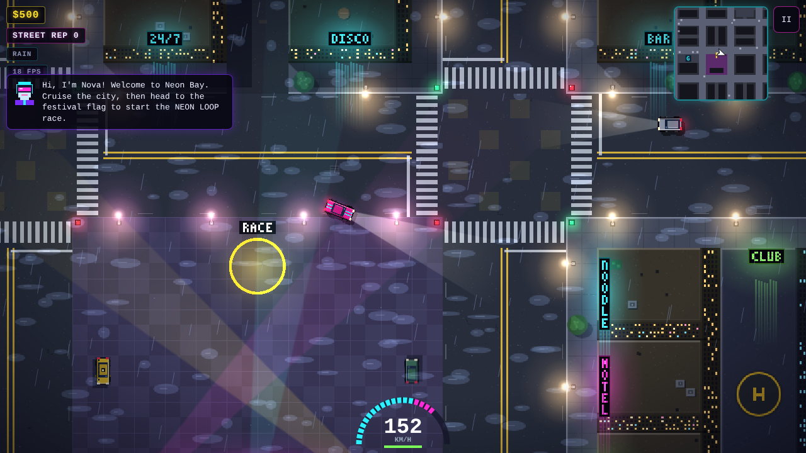
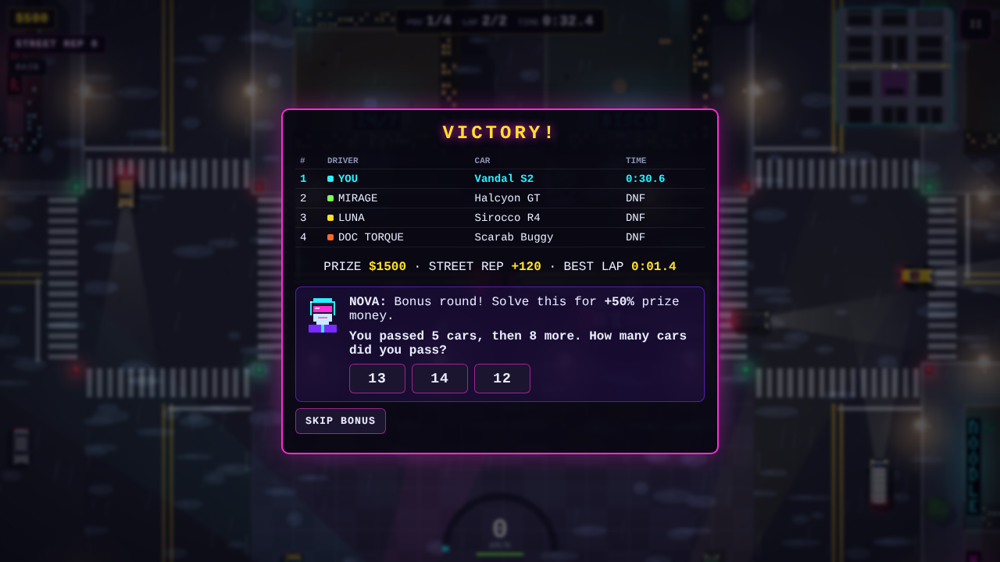

# NIGHT RACERS 🌙 — Neon Bay Maths Missions

Open-world, top-down arcade racing with an educational twist, built for the browser (mobile-first).
This is **Milestone 1: the playable Neon City prototype** from the [design spec](docs/SPEC.md).

## Run it

```bash
npm install
npm run dev        # http://localhost:5173 (also reachable from a phone on the same Wi-Fi)
npm run build      # type-check + production build into dist/
npm run preview    # serve the production build
```

Add `?fps=1` to the URL to show the frame-rate counter (also toggleable in the pause menu).

## Controls

| Action | Keyboard | Touch |
| --- | --- | --- |
| Accelerate | W / ↑ | GAS |
| Brake / reverse | S / ↓ | BRAKE |
| Steer | A D / ← → | Steering pad (analog) |
| Drift (handbrake) | Space | DRIFT |
| Interact (start race, repair) | E / Enter | Contextual button |
| Zoom | + / − / mouse wheel | Pause menu slider |
| Pause | Esc / P | II button |

Touch controls appear automatically on touch devices. In the pause menu you can resize them, drag them to new
positions (MOVE CONTROLS), or reset the layout. The layout is remembered per device.

## What's in Milestone 1

1. **Detailed pixel-art city.** The map is a procedurally drawn 128×128-tile Neon City (4096 px²). It has downtown blocks with
   rooftop detail (AC units, water tanks, helipads, skylights, roof gardens), lit facades, alleys, parks with ponds,
   parking lots, a construction site (gravel and mud), the Neon Bay Festival plaza, a garage, and the coastal boardwalk and bay.
   There are road markings, crosswalks, stop lines, curbs and manholes, plus 3×5 pixel-font neon signs (some flicker),
   street lamps, animated traffic lights, blinking rooftop beacons, festival searchlights and shimmering water.
2. **Player car.** The Vandal S2 (STREET class) has a shadow, headlight cones, brake lights, magenta underglow,
   smoke when damaged, and skid marks.
3. **GTA 2-style camera.** It keeps the car near the centre with smooth interpolation, looks ahead in the direction of travel,
   never rotates, zooms out slightly at speed, has adjustable zoom, shakes on impacts and is clamped to the world bounds.
4. **Arcade physics** (`Vehicle.ts`). It models acceleration, braking and reverse, speed-sensitive steering,
   lateral grip, handbrake drifts and momentum. Surfaces (asphalt, concrete, gravel, mud, grass, sand) change grip, acceleration
   and top speed, scaled by each vehicle class's off-road sensitivity. Wet roads reduce grip, and damage reduces performance.
5. **Collisions.** Cars collide with buildings, water, lamps, trees and parked cars, with each other (impulse-based), and
   with traffic. Glancing hits spin the car.
6. **Civilian traffic.** About 34 lane-following cars drive on the road graph. They obey the traffic lights, queue behind
   other cars (and you), take curved turns, use a deadlock breaker, and are recycled around the player. Distant cars run a cheaper update.
7. **Mobile controls.** There is an analog steering pad and GAS/BRAKE/DRIFT buttons, all multi-touch, plus a contextual
   action button. Size and position are editable.
8. **Mini-map.** It shows a player-centred view with traffic, rivals, the race route, the next checkpoint, and the race and
   garage icons.
9. **Race event: NEON LOOP.** Drive into the yellow RACE ring at the festival and press E or RACE. It is a 2-lap street race
   against 3 AI rivals drawn from a mixed-class roster. It has a countdown, checkpoints with direction chevrons,
   a chequered start/finish line, lap counting, live positions and a HUD arrow. At the end a results screen shows money and
   street-reputation rewards. Rivals have different personalities (skill, aggression, racing line), corner braking,
   stuck recovery and mild rubber-banding.
10. **Nova and maths.** Nova greets you and gives tips without blocking play. After each race she offers an optional
   bonus question (+50% prize). Its difficulty adapts across 8 levels, from addition up to speed × time, and the
   questions use racing themes. Free roaming is never interrupted.
11. **Garage.** Drive to the GARAGE ring to repair damage (costs money).
12. **Dynamic weather.** The weather moves between clear, drizzle, rain and storm, with rain streaks and thunder flashes.
    Roads get wet and dry gradually, and the wet layer adds puddles plus neon and lamp reflections.
13. **Audio.** All sound is procedural Web Audio: an engine with gear changes, tyre squeal, crashes, rain, thunder and countdown beeps.
14. **Saves.** Money, reputation (street, rally, circuit, off-road and drag), maths level and best times are
    saved in IndexedDB.

## Architecture

Phaser 3 + TypeScript + Vite. The only runtime dependency is Phaser, and all art and audio are generated in code.

```
src/
  config.ts                 world constants (tile size, grid, depths, directions)
  main.ts                   boot: load save → start Phaser
  scenes/GameScene.ts       orchestrates systems each frame
  world/CityMap.ts          deterministic city generation (tiles, buildings, props, signs, zones)
  world/Tiles.ts            tile ids + surface physics table
  world/ChunkRenderer.ts    draws a 512px chunk (ground, markings, buildings, props, wet layer)
  world/ChunkManager.ts     chunk streaming: build visible, preload neighbours, unload far; animated props
  gfx/SpriteFactory.ts      procedural car sprites, glows, light cones, neon sign textures
  gfx/PixelFont.ts          3×5 pixel font
  vehicles/VehicleData.ts   6 classes × 2 vehicles (stats + looks), traffic looks
  vehicles/Vehicle.ts       reusable arcade physics body + sprites/lights
  physics/Collision.ts      circle-vs-tile/prop, body-vs-body, body-vs-kinematic
  ai/Traffic.ts             lane graph traffic with pooling and LOD
  ai/TrafficLights.ts       deterministic signal timing
  race/RaceManager.ts       race definition, grid, checkpoints, laps, standings
  race/RacerAI.ts           rival driver personalities and driving
  systems/{Weather,Audio,Input,Save}.ts
  ui/{Hud,TouchControls,Menus}.ts
  edu/Nova.ts               adaptive maths questions + Nova portrait
```

Performance notes: the world is baked into chunk textures, so each chunk is 2 sprites (base plus wet overlay). Chunks are
streamed, so only about 9–20 are resident. Glow and light sprites live with their chunk and are freed with it. Traffic is pooled
and hidden or simplified off-screen. Skid marks use a fixed ring buffer. The HUD redraws at 20 Hz.

## Not yet built (next milestones)

The other four districts (Industrial, Wildlands, Racing Park, Coastal Highway), dealership and garage upgrades, the other race types
(rally, drag, circuit, sprint, time attack), jumps, per-car engine voices, Tiled map import and championships.
The roster of 12 vehicles is defined. AI rivals already use all of them, but the player can't buy or switch cars yet.

## Screenshots




